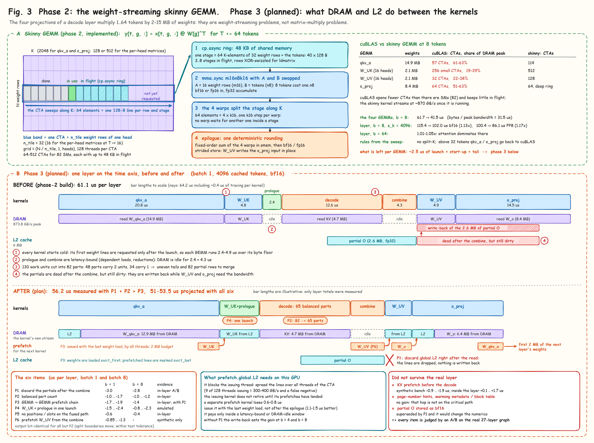

# Phase 3 (planned): the time between the kernels

> **Status: plan.** Nothing on this page is implemented in this branch. Every number comes from a prototype measured on
> the real 27-layer CUDA graph (an extra kernel, a patched copy of a kernel, a scheduler knob, parallel graph branches)
> or, where noted, from a synthetic benchmark. The prototype harnesses are in
> [research/phase3/](../../research/README.md), which also says which script backs which item.

Phase 3 covers three requests: L2 prefetch between the GEMMs, horizontal fusion of W_UK with the prologue, and the
small-batch items that were postponed in phase 2. Panel B of Figure 3 shows the idea on a time axis.



## 0. Conclusion

At small batch three things in a layer can be taken back: the fp32 partial outputs that the decode kernel writes are
flushed to DRAM although nobody needs them any more; DRAM is idle between kernels; and the parts are cut unevenly.

Six items, P1–P6. Expected: b=1 from 61.1 to 51–53.5 µs per layer (−12% to −16%), b=8 with bf16 KV from 101.7 to
93–95.5 µs (−6% to −9%), b≥32 essentially unchanged. P1 + P2 + P3 stacked were measured in the real layer: b=1
61.1 → 56.2 µs, b=8 101.7 → 97.4 µs.

| # | Item | Evidence | b=1, µs per layer | b=8, µs per layer | Output bit-identical |
|---|---|---|---|---|---|
| P1 | `discard.global.L2` after the combine has read the partial outputs | in-layer A/B | −3.0 | −2.8 | yes |
| P2 | Scheduler rule: balanced part count | in-layer | −1.0 to −1.7 | −1.0 to −1.2 | no (split boundaries move; within tolerance) |
| P3 | GEMM → GEMM prefetch chain, weights loaded `evict_first` | in-layer, patched kernel copy | −1.7 to −1.9 | −1.4 | yes |
| P4 | W_UK and the prologue in one launch | in-layer, emulated with parallel graph branches | −1.5 to −2.4 | −0.8 to −2.3 | yes |
| P5 | The fused path stops computing positions and slots | in-layer | −0.6 | −0.4 | yes |
| P6 | Prefetch W_UV from inside the combine | synthetic benchmark only | −0.85 to −1.3 | not measured | yes |

- The P3 numbers were measured with P1 in place. Without the discard, the prefetch gains nothing at b=4 and b=8.
- P6 has only synthetic evidence. It gets an in-layer A/B before it is kept.
- The three ideas originally filed under "small batch" (physical page numbers in the metadata row, an L2 prefetch before
  the decode, partial outputs stored as bf16) are all dropped; see section 3. The small-batch work became P1, P2 and P5.

## 1. Evidence

### 1.1 One layer at batch 1 on the time axis

Nsight Systems trace of the 27-layer graph, b=1, s_k=4096, bf16; each kernel includes about 0.4 µs of tracing overhead.

| Kernel | Time µs | Byte floor µs | Above | Where the excess comes from | Item |
|---|---|---|---|---|---|
| qkv_a (14.9 MB) | 20.80 | 17.1 | +3.7 | launch, start-up and tail; the weights are not prefetched | P3 |
| W_UK (2.1 MB) | 4.77 | 2.4 | +2.4 | same | P3, P4 |
| prologue | 2.40 (FP8: 3.84–4.06) | 0 | +2.4 | latency-bound: block table → RMSNorm → cache write | P4 |
| decode (4.7 MB of KV) | 12.64 | 5.4 | +7.2 | start-up chain, uneven parts, writing the partials | P2 |
| combine | 4.29 (b=8: 6.46) | 0 | +4.3 | latency-bound: LSE → weights; reads 2.6 MB of partials from L2 | P6 uses this idle DRAM window |
| W_UV (2.1 MB) | 4.87 | 2.4 | +2.5 | the dirty partial lines are written back and compete with the weight stream | P1, P6 |
| o_proj (8.4 MB) | 14.46 | 9.6 | +4.9 | same; the weights are not prefetched | P1, P3 |
| Total | 64.2 | 37.0 | +27 | | |

A dependent empty kernel in a graph costs 0.67 µs, so the seven launches account for about 4.7 µs. Only P4 removes one.

### 1.2 Mechanisms confirmed during the research

**Write-back of the partial outputs.** The decode kernel writes its fp32 partial outputs into L2 (2.6 MB at b=1, 2.8 MB
at b=8). After the combine has read them, the lines are still dirty and get written back to DRAM while W_UV and o_proj
are streaming weights.

- Synthetic chain: adding 2.7 MB of dirty data takes it from 39.9 to 48.4 µs per layer; discarding the data after the
  read brings it to 44.9 µs.
- Real layer: discard minus no-op is −2.6 to −3.3 µs per layer at b = 1, 4, 8 and −0.4 to −0.8 at b=32, the same for bf16
  and FP8 KV, with bit-identical output on all seven shapes tested.

**How `prefetch.global.L2` behaves on this GPU.**

- It blocks the thread that issues it: a thread has one prefetch in flight at a time. Prefetches must therefore be
  spread over all threads of a CTA. An early negative result came from letting 9 threads per CTA issue everything
  (300–400 GB/s).
- The issuing kernel does not retire until its prefetches have landed.
- It pays only inside a latency-bound or DRAM-idle window. A separate, serial prefetch kernel loses (39.33 → 40.03 µs).
- Issuing after the GEMM epilogue is 1.1–1.5 µs per layer worse than issuing together with the last weight load.

**Synthetic results do not transfer to the layer.** Two counter-examples from this research:

- Prefetching the first KV tile before the decode: −0.9 to −1.9 µs in a synthetic chain, +0.1 to +1.7 µs in the layer.
- GEMM prefetch budget: 1 MB is best in the stand-alone chain, 2 MB is better in the layer.

So every item below is judged by an A/B on the real layer, and P6 stays a candidate until it has one.

**Part count.** The fastest choice is the fewest parts for which the heaviest part is no heavier.

- b=1, s_k=4096: 130 units. With 82 parts, 48 parts have two units and 34 have one. With 65 parts, all have two. The
  critical path is the same, there are 20% fewer partial rows, and the layer is 1.7 µs faster.
- Fewer parts than that get slower quickly: a minimum of 4 units per part costs +0.25 µs per layer, 8 units +7.5,
  16 units +23. A fixed minimum is not usable; the rule has to follow the load.

**A limit of the tooling.** Nsight Compute's kernel replay cannot measure L2 state that crosses kernels (the numbers it
gives are implausible). All decisions in this phase rest on graph-timing A/Bs.

### 1.3 External sources

- `discard`: the CCCL documentation defines
  [`cuda::discard_memory`](https://nvidia.github.io/cccl/unstable/libcudacxx/extended_api/memory/discard_memory.html) as
  dropping modified cache lines without writing them back, equivalent to storing indeterminate values, with no hardware
  store; its stated use is global memory used as scratch space. It is a hint.
- Hazy Research, ["Look Ma, No Bubbles!"](https://hazyresearch.stanford.edu/blog/2025-05-27-no-bubbles) (Llama-1B on
  an H100): seven kernels per layer, about 5 µs at each kernel boundary without weights being read, 1.3 µs for an empty
  kernel in a graph; one of their remedies is to start reading the next instruction's weights while the previous one is
  still writing results. P3 does the same thing without merging the kernels. A megakernel is out of scope here.

## 2. The six items

Every item gets an environment switch, default on, so that it can be A/B-tested and turned off on its own.

### P1: discard the dirty partial lines after the combine has read them

**Change.** Both combine kernels in `csrc/sm86/mla_decode_sm86.cuh` (the 8-bit path uses the same two kernels).

Wide kernel, after the last `__syncthreads()`: the threads with `(c & 7) == 0` discard the line they read, for every
split they read.

```cpp
if (params.discard_partials && (c & 7) == 0)
    for (int sp = grp; sp < nsp; sp += NG)
        asm volatile("discard.global.L2 [%0], 128;" :: "l"(oa + (int64_t)sp * sstride) : "memory");
```

Warp kernel, after the accumulation loop: the lanes with `(lane & 7) == 0` do the same for the four quarters of every
split. `discard_partials = env(FLASH_MLA_SM86_DISCARD, 1) && oaccum_ptr % 128 == 0`, set in `csrc/flash_api.cpp`.

**Why it is correct.**

- A 128-byte line is read by 8 neighbouring threads of one warp (wide kernel) or 8 neighbouring lanes (warp kernel). The
  discard comes after the accumulation, so all reads of the line are complete.
- A line belongs to exactly one CTA (wide: one CTA per row and quarter) or one warp (warp kernel: one warp per row), so
  no data is discarded that someone else has yet to read.
- A partial output row is 2048 bytes, a multiple of 128. With an aligned base the discard cannot touch the LSE or the
  counters; with an unaligned base it is switched off.
- After a discard the content is indeterminate, but it is always rewritten before the next read: the split rows the
  combine reads are exactly those the decode kernel wrote in the same call.
- It is a hint and cannot change the output.

**Out of scope.** The optional fused last-arriver combine (`FLASH_MLA_SM86_FUSE > 0`).

**Expected.** −2.6 to −3.3 µs per layer at b = 1, 4, 8; −0.4 to −0.8 at b=32; nothing at b≥64, where most rows have one
split.

**Go / no-go.** At least −2.0 µs per layer at b = 1, 4, 8 (bf16 and FP8); b=32 and b=64 not slower by more than 0.3%;
stand-alone decode at b≤4 not slower by more than 0.2 µs.

### P2: balanced part count

**Change.** `csrc/flash_fwd_mla_metadata.cu`, where the effective part count is computed.

```cpp
long long Pe = P < total ? P : total;
if (params.balance_parts) {                      // fewest parts whose heaviest part is no heavier than with P parts
    const long long u = (total + P - 1) / P;     // units of the heaviest part with P parts
    Pe = (total + u - 1) / u;                    // <= P, and every part still owns <= u units
}
// the existing minimum-units cap follows unchanged
```

Switch: `FLASH_MLA_SM86_BALANCE` (default 1), read when the metadata is built.

**Why it is correct.**

- `Pe = ceil(total / u)`, so `total / Pe ≤ u`: no part owns more than `u` units, the heaviest part is as heavy as today.
  `Pe ≤ P` and `Pe ≤ total`: no empty parts, split indices stay contiguous.
- The form of the cut does not change, only `Pe` gets smaller, on the same code path as the existing minimum-units knob.
  The legacy kernel reads only the first five ints of a row and is unaffected.
- The load per part stays a single launch-wide value, so the gate for the two KV groups remains uniform.
- Large batches hardly change: when `total` is much larger than `P`, `Pe` is 81 or 82.

**Caveats.**

- The research emulated the rule with a minimum of `ceil(total / 82)` units, which yields `floor(total / u)` parts. For
  4 of the 15 shapes that differs from the real rule by one part (b=1 s_k=8192: 64 vs 65; b=1 s_k=16384: 73 vs 74; b=4:
  74 vs 75; b=32 s_k=1024: 77 vs 78). The real rule never has a heavier heaviest part. Re-measure the same table after
  implementing.
- Split boundaries move, so the output is no longer bit-identical to today's default; it stays within the test
  tolerance (cosine distance below 8e-5) and bit-identical from run to run.
- Phase 1 moved from a cut that left about 17 of 82 SMs idle at b=1, s_k=8192 to the 82-part balanced cut. P2 uses fewer
  parts again, but balanced ones, and only as long as the heaviest part does not grow. That earlier decision was judged
  on the stand-alone kernel, which is why the go / no-go below includes the stand-alone matrix.

**Expected** (rule alone, µs per layer; the two numbers are with and without P1 in place):

| Shape | Gain | Shape | Gain |
|---|---|---|---|
| b=1, s_k=4096 | −1.0 to −1.7 | b=16, s_k=4096 | −3.1 |
| b=2, s_k=4096 | −2.3 to −2.8 | b=4, s_k=1024 | −0.8 to −1.5 |
| b=3, s_k=4096 | −0.6 to −0.8 | b=8, s_k=1024 | −1.8 to −2.4 |
| b=4, s_k=4096 | −1.2 to −1.5 | FP8, b=1 | −0.7 to −1.3 |
| b=8, s_k=4096 | −1.0 to −1.2 | FP8, b=8 | −1.5 to −1.7 |
| b=1, s_k=8192 / 16384 | −0.3 to −1.0 | FP8, b=4 | −0.2 to −0.5 |
| b=1, s_k=2048 | flat | b=32, s_k=1024 | −0.2 |

**Go / no-go.** None of these 15 shapes slower than today by more than 0.2 µs; `bench_decode --preset core`, graph and
eager, geometric mean at least 1.00 and no cell more than 1% slower. Otherwise enable it only below a row-count
threshold, or drop it.

**New test.** For random lengths: number of non-empty parts equals `ceil(total / ceil(total / P))`, the heaviest part is
at most `ceil(total / P)`, and every unit is covered exactly once.

### P3: GEMM → GEMM prefetch chain, weights loaded `evict_first`

**Chain.** qkv_a → W_UK; W_UV → o_proj; o_proj → the next layer's qkv_a. W_UK is followed by attention and has no GEMM
successor.

**Change.**

- `SkinnyGemmParams` gains `pf_ptr / pf_rows / pf_pitch / pf_lines / evict_first`.
- In `skinny_gemm.cu`, the weight `cp.async` becomes `cp.async.cg.shared.global.L2::cache_hint` with a
  `createpolicy.fractional.L2::evict_first.b64` policy (the token loads stay as they are). In the iteration that issues
  the last weight load (`c == max(0, nc − (kStages − 1))`) the kernel calls `prefetch_next`: the lines to prefetch are
  divided evenly over the CTAs by linear CTA index and over the threads within a CTA, with
  `prefetch.global.L2::evict_last`.
- `skinny_gemm` in `fused_api.cpp` gets an optional `next_w`. Rows = `numel / K_next`, pitch = `K_next × 2` bytes, lines
  per row = `min(pitch / 128, budget / (rows × 128))`, at least 1. Budget from `FLASH_MLA_SKINNY_PF_BYTES`, default
  2 MiB, 0 = off.
- `skinny_bmm` / `skinny_linear` in `flash_mla/skinny_gemm.py` get `next_w=None`; `mla_decode_layer.py` passes it at
  three call sites; each layer object gets `next_w_qkv_a`, linked in layer order by `capture_layer_graph` (empty for the
  last layer).

**Why it is correct.** Prefetch and cache policy are hints. The addresses are computed from the shape of `next_w` and
cannot go out of bounds (it must be contiguous and on the same device). The pointer is baked into the graph like every
other argument; weights are static.

**Expected** (with P1, 2 MB budget, µs per layer): b=1 −1.7 to −1.9; b=4 −1.7; b=8 −1.4; FP8 b=1 −1.65; FP8 b=8 −1.25;
b=1, s_k=1024 −1.7. `evict_first` alone gives −0.5 to −0.7, the prefetch alone −1.2; 1 MB is 0.3 worse than 2 MB; 3 MB
equals 2 MB.

**Not measured.** The patched kernel copy supported T ≤ 8 only; T = 9…32 has to be measured after implementing. Above
32 tokens qkv_a and o_proj run on cuBLAS and the chain is broken, so `next_w` is not passed.

**Go / no-go.** With P1 in place at least −1.0 µs per layer at b = 1, 4, 8 (bf16 and FP8); b=16 and b=32 not slower;
bit-identical output with and without `next_w`. Sweep the budget over 1 / 2 / 3 MB once more to fix the default.

### P4: W_UK and the prologue in one launch

**Today.** W_UK (grid 32 × 1 × 16, 128 threads, DRAM-bound, 4.8 µs) is followed by the prologue (grid (H + 1) × T,
96 threads, latency-bound, 2.4 µs with bf16 KV and 3.8–4.1 µs with FP8). The q-head blocks of the prologue copy the W_UK
output once more into `q_full`. The two kernels read disjoint inputs (different slices of the qkv_a output) and could
run at the same time.

**Two steps.**

- **P4a** (useful on its own). The W_UK epilogue writes `q_full[..., :512]` directly (`y_sg = 576`, `y_st = H × 576`; the
  strided interface already allows it). The prologue drops the q_nope copy and becomes one 128-thread CTA per token:
  threads 0–63 do kv_c (RMSNorm, quantize, cache write), warp 2 does the RoPE of k_pe, warp 3 the RoPE of q_pe for all
  heads of the token. After this step the two kernels no longer depend on each other.
- **P4b.** A new `csrc/fused/wuk_prologue.cu` with `wuk_prologue_kernel(SkinnyGemmParams, MlaPrologueParams)`.
  - The bodies of the two existing kernels become `__device__ __forceinline__` functions; the two kernels stay (fallback,
    T out of range, unfused layers).
  - Grid `(N / n_tile, 1, G + zr)` with `zr = ceil(T / (N / n_tile))`. CTAs with `blockIdx.z < zr` run the prologue
    (token = `z × gridDim.x + x`, returning at once beyond T), the others run the GEMM (group = `z − zr`). The prologue
    CTAs have the lowest indices, are scheduled first, and their memory chain overlaps the W_UK weight stream.
  - Entry point `mla_wuk_prologue` in `fused_api.cpp`, a wrapper in `flash_mla/mla_prologue.py`, and
    `mla_decode_layer.py` uses it for fused layers when the skinny GEMM is available. Switch `FLASH_MLA_FUSE_WUK`
    (default 1).

**Why it is correct.**

- The writes are disjoint: W_UK writes `q_full[..., :512]`; the prologue writes `q_full[..., 512:]`, the KV cache row
  and `kv_scale`. The reads are different slices of the qkv_a output, the block table, the lengths and the RoPE table.
  No ordering between CTAs is needed.
- The rounding of the GEMM and the formulas of RoPE, RMSNorm and quantization do not change, so `q_full`, the KV cache
  and the layer output should be bit-identical.
- Kernels per layer: 7 → 6.

**Why not two graph branches** (which is how the research emulated it). They add a fork / join pair to the graph and
need cross-stream events in eager mode, where they would be slower. One launch works in both modes and saves a launch
(0.67 µs). The emulated numbers are a lower bound.

**Expected** (µs per layer): b=1 bf16 −1.5 to −2.4; b=1 FP8 −1.9 to −2.1 (removing the prologue entirely would give
−3.4); b=8 bf16 −0.8 to −2.3; b=8 FP8 −1.5 to −2.2; b=32 nothing. A repeat of the emulation gave b=1 −1.7, b=4 −0.75,
b=8 −0.8.

**Go / no-go.** At least −1.0 µs per layer at b=1 and b=8 (bf16 and FP8) under a graph; eager not slower; in the trace the
fused kernel takes at most max(W_UK, prologue) + 0.5 µs. Otherwise keep P4a only.

**Deliberately not included.** A prefetch of the first KV tile from the prologue (section 3).

### P5: no positions / slots on the fused path

**Change.** In `flash_mla/mla_decode_layer.py`, `positions` and `slots` of the decode state become lazily computed
properties. `refresh` marks them stale and computes only the metadata. The unfused path computes them on access, as
before, and so does capture.

**Why it is correct.** The fused prologue kernel derives the write position from the lengths and the block table itself
and never reads these two tensors.

**Expected.** About 13 small PyTorch kernels fewer per step: −10 to −20 µs per step, −0.4 to −0.6 µs per layer,
bit-identical.

### P6 (conditional): prefetch W_UV from inside the combine

**Rationale.** The combine is latency-bound and leaves DRAM idle for 4.3–6.5 µs. W_UV is 2.1 MB, 2.4 µs at 870 GB/s, so
it fits. In a synthetic benchmark (reader kernel padded to 4.3 µs, with discard) it gives −0.85 to −1.3 µs per layer, and
−1.75 to −2.2 together with the GEMM chain. Issuing early or late in the kernel makes no difference beyond noise.

**Change.** `Flash_fwd_mla_params` gains `pf_ptr / pf_bytes`; `flash_mla_with_kvcache(..., prefetch=None)`; both combine
kernels, after issuing the loads of the partials, let every thread issue its share of the prefetch lines (`evict_last`,
divided over the threads of all CTAs, placed before the early-exit test so that every line has an issuer). The layer
passes `w_uv_t`, only for T ≤ 32.

**Risks.** Synthetic evidence only; it may flip in the layer as the KV prefetch did. L2 has to hold the partials
(2.6–2.8 MB) and W_UV (2.1 MB) at the same time, which is tight in 6 MB.

**Go / no-go.** In-layer A/B after P1 and P3: at least −0.5 µs per layer at both b=1 and b=8, otherwise revert and
record it as rejected.

## 3. Rejected in the research

| Idea | Why | Retry when |
|---|---|---|
| Prefetch the first KV tile before the decode (from the prologue, or from a parallel branch) | all three placements slower in the layer at b = 1, 4, 8 by 0.1–1.7 µs; the synthetic gain came from a purely idle window, which the layer does not have: the metadata → block table chain and DRAM competition with W_UK cancel it | the start-up chain of the decode kernel is restructured, or on sm_90+ with programmatic dependent launch |
| Physical page numbers in the metadata row | warming only the metadata and block table gains nothing (42.03 vs 41.96 µs): that hop is not on the critical path; it would also make the metadata depend on the block table | never |
| A separate, serial prefetch kernel | it does not retire until the prefetches land, plus one launch: 0.6–0.8 µs per layer lost | never |
| Prefetch issued after the GEMM epilogue | 1.1–1.5 µs per layer worse than issuing with the last weight load | never |
| Partial outputs stored as bf16 | P1 removes the write-back; what is left is traffic inside L2; it would also change the numerics | the profiler still shows significant DRAM writes from the decode kernel after P1 |
| Combine and W_UV in one kernel | the combine is one CTA per output row, W_UV streams weight tiles; the structures do not match, and P6 reaches the same goal with a prefetch | P6 fails and W_UV is still clearly above its byte floor |
| Spin-waiting to imitate programmatic dependent launch | burns SMs and can deadlock | never |
| A megakernel | rewriting seven kernels as one interpreter-style kernel is beyond this phase | a decision to invest |
| A different `n_tile` or split-K for o_proj | 32 × 1 is already the best; the excess inside the layer is mostly the write-back, which P1 removes | never |
| A fixed minimum of units per part | too large a value is catastrophic (b=1: 4 → +0.25, 8 → +7.5, 16 → +23 µs per layer) | never; replaced by P2 |

## 4. Order of implementation

| Step | Content | Depends on | Commit |
|---|---|---|---|
| 0 | Save reference outputs of the current build (27-layer graph: b 1 / 4 / 8 / 32 × bf16 / FP8; a few stand-alone decode shapes) | | none |
| 1 | P1 discard | | own commit |
| 2 | P2 balanced parts; then save the reference outputs again | | own commit |
| 3 | P5 lean bookkeeping | | own commit |
| 4 | P3 GEMM prefetch chain | P1 | own commit |
| 5 | P6 prefetch W_UV from the combine (A/B first) | P1, P3 | only if it passes |
| 6 | P4a, then P4b | | two commits |
| 7 | Full matrix, report, README, regenerated benchmark matrix | all | documentation commit |

- P1 first: largest gain, smallest change, and P3 depends on it.
- P2 second: it changes the last bits of the output, so everything after it is checked bit-for-bit against new
  references.
- P4 last: it is the largest change (two kernel bodies refactored, a new kernel and entry point).
- An item that fails its go / no-go is reverted and recorded as rejected.

## 5. Verification and targets

**Correctness.**

- The full test suite (760 tests today).
- Bit-for-bit regression: outputs of P1, P3, P4, P5, P6 `torch.equal` to the references; P2 within tolerance.
- New tests: the metadata properties of P2; equivalence with and without `next_w`; `mla_wuk_prologue` bit-for-bit
  against W_UK followed by the prologue (bf16 / FP8 / INT8, T = 1 / 2 / 8 / 32); equivalence with the discard on and off.
- `compute-sanitizer`: memcheck on the combine with discard; racecheck and memcheck on `wuk_prologue_kernel`.

**Timing.** `bench_layer.py` over b = 1 / 2 / 4 / 8 / 16 / 32 / 64 × s_k = 1024 / 4096 × bf16 / FP8, graph and eager;
`bench_decode.py --preset core`, graph and eager (P1 and P2 affect the stand-alone decode). The first repetition of a
configuration is often 1–3 µs high; use the later ones. Existing measurements serve as the "before" wherever they match
build, shape and configuration.

**Composition.** An Nsight Systems trace to confirm 7 → 6 kernels per layer and the duration of each.

**Targets** (graph, s_k=4096, µs per layer):

| Shape | Today | Target | P1 + P2 + P3 already measured |
|---|---|---|---|
| b=1, bf16 | 61.1–61.5 | ≤ 54 | 56.2 |
| b=2, bf16 | 67.5 | ≤ 60 | 61.4 |
| b=4, bf16 | 78.4 | ≤ 72 | 73.7 |
| b=8, bf16 | 101.7–102.3 | ≤ 96 | 97.4 |
| b=1, FP8 | 61.6 | ≤ 55 | 57.4 |
| b=8, FP8 | 86.3–86.9 | ≤ 81 | 82.5 |
| b=32 / b=64, bf16 | 239.5 / 431.4 | not slower by more than 0.5% | not run |

In the "already measured" column the discard is an external kernel with its own launch (0.7–0.9 µs), which goes away
once the discard is inside the combine.

## 6. Risks

- The gains are not fully additive. P1, P2 and P3 measured together are close to additive; P4, P5, P6 and their
  combinations have not been measured together.
- `discard` and `prefetch` are hints. Their effect depends on this card and driver (RTX 3090, driver 570) and has to be
  re-measured on other hardware.
- P2 changes the last bits of the output. Anything downstream that compares bit-for-bit against an older build has to
  know that.
- P3 has no data for T = 9…32; P6 has only synthetic data.
- P4b multiplies template instances (GEMM configurations × prologue configurations) and build time; instantiate only the
  combinations the layer uses.
- In the fused kernel the prologue CTAs and the GEMM CTAs have different bytes in flight, the situation that broke the
  per-part KV-group choice in phase 2. There are at most T prologue CTAs and they have no `cp.async` stream, so it is
  expected to be harmless; a trace has to confirm that the W_UK part does not get slower.

## 7. Files that will change

- `csrc/sm86/mla_decode_sm86.cuh`: combine kernels (P1, P6).
- `csrc/flash_fwd_mla_metadata.cu`, `csrc/sm86/mla_sm86.h`: scheduler rule and switches (P2).
- `csrc/fused/skinny_gemm.{h,cu}`, `csrc/fused/fused_api.cpp`, `flash_mla/skinny_gemm.py`: prefetch chain (P3).
- `csrc/fused/mla_decode_prologue.cu`, new `csrc/fused/wuk_prologue.cu`, `flash_mla/mla_prologue.py`: horizontal fusion
  (P4).
- `flash_mla/mla_decode_layer.py`: call sites of P3, P4, P5.
- `csrc/flash_api.cpp`, `csrc/flash_mla.h`: parameter fields (P1, P6).
- Existing prototypes to measure against: `research/phase3/`.
