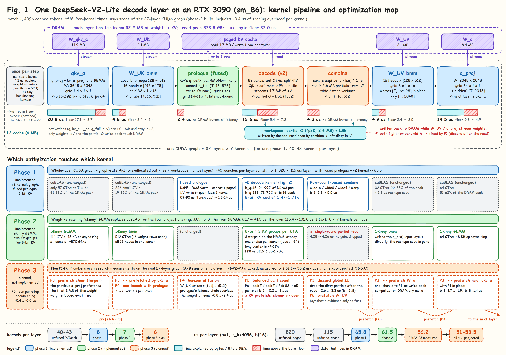
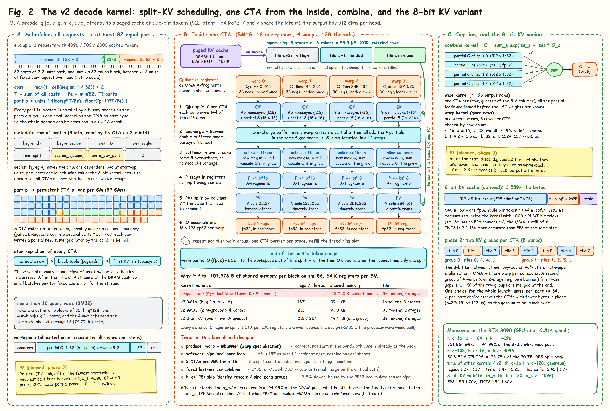
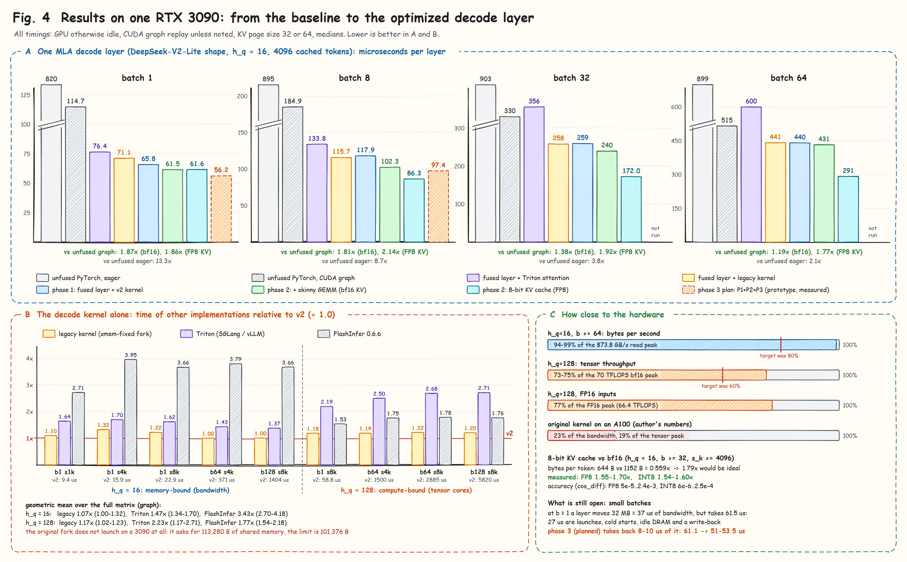

# MLA decode on an RTX 3090: the optimization write-up

This directory collects everything that was done to make MLA decode fast on GeForce Ampere (RTX 3090, sm_86): the
measured results, the design of each optimization, the plan for the next phase and the experiments that failed.

| Document | Content |
|---|---|
| [01-results.md](01-results.md) | Hardware ceilings, every baseline → optimized table, accuracy, correctness |
| [02-phase1-decode-kernel.md](02-phase1-decode-kernel.md) | The v2 decode kernel, scheduler, combine, graph-safe API, 8-bit KV cache, fused prologue, whole-layer CUDA graph |
| [03-phase2-gemm-kv-groups.md](03-phase2-gemm-kv-groups.md) | Weight-streaming skinny GEMM for the layer projections; two KV groups per CTA for the 8-bit kernel |
| [04-phase3-plan.md](04-phase3-plan.md) | Planned, not implemented: discard of dead partials, balanced part count, GEMM prefetch chain, W_UK + prologue in one launch |
| [05-what-did-not-work.md](05-what-did-not-work.md) | Rejected approaches with numbers, reasons and retry conditions; rules learned |
| [figures/](figures/) | The four figures (SVG and PNG) and the scripts that draw them |
| [../../research/](../../research/README.md) | Code behind the numbers that is not part of the library: the phase-3 prototype harnesses and the patches of rejected phase-2 experiments |

The original working report, written in Chinese while the work was in progress, is
[../ampere_opt_report.md](../ampere_opt_report.md). The documents here restate it in English and add phase 3.

## Status

| Phase | Scope | State |
|---|---|---|
| 1 | v2 decode kernel (bf16 / fp16), scheduler, combine variants, graph-safe API, 8-bit KV cache, fused prologue, decode layer as one CUDA graph | implemented, tested, measured |
| 2 | Skinny GEMM for the four layer projections; two KV groups per CTA for the 8-bit kernel | implemented, tested, measured |
| 3 | Six items that remove fixed cost between kernels at small batch | researched with prototypes on the real layer (`research/phase3/`); plan written; not implemented in the library |

## The figures

**Figure 1** is the map: the seven kernels of one decode layer, what each one streams from DRAM, how far each is above its
byte floor, and which optimization of which phase touches it.

**Figure 2** opens the attention kernel: how requests are cut into parts, what one CTA does with its four warps, how the
partial results are merged, and what changes for the 8-bit KV cache.

**Figure 3** shows the skinny GEMM of phase 2 and, on a time axis, what DRAM and L2 do during one layer before and after
the phase-3 items.

**Figure 4** is the result chart: the decode layer from the unfused baseline to the current build, the decode kernel
against other implementations, and the distance to the hardware ceilings.

## The problem in three numbers

- **1.89 · M FLOP per byte.** One cached token is 576 values (512 latent + 64 RoPE), 1152 bytes in bf16. Every query row
  does 2 · 576 FLOP for QK and 2 · 512 for PV against it. With M = h_q × s_q query rows the arithmetic intensity is about
  1.89 · M FLOP/B.
- **80 FLOP per byte.** That is where the RTX 3090 turns from memory-bound to compute-bound: 70.0 TFLOPS of bf16 tensor
  throughput (FP32 accumulation runs at half rate on GeForce cards) over 873.8 GB/s of read bandwidth. It corresponds to
  M ≈ 42. DeepSeek-V2-Lite (h_q = 16, 30 FLOP/B) is a pure bandwidth problem; h_q ≥ 64 is a tensor-core problem.
- **101,376 bytes.** The shared memory one block can have on sm_86. The original Ampere port keeps Q, double-buffered K
  and P in shared memory and needs 113,280 bytes, so it does not launch.

The three phases follow from this. Phase 1 builds a kernel that fits and reaches the ceiling of each regime. Once the
attention kernel is at the ceiling, the layer around it becomes the cost: phase 2 fixes the projections, phase 3 the gaps
between kernels.

## Notation

| Symbol | Meaning |
|---|---|
| `b` | batch size (requests decoded together) |
| `s_k` | cached tokens per request |
| `s_q` | query tokens per request (1, or 2 for multi-token prediction) |
| `h_q` | query heads (16 for DeepSeek-V2-Lite, 128 for DeepSeek-V2 / V3) |
| `M` | query rows per request, `h_q × s_q` |
| `T` | tokens entering a layer projection, `b × s_q` |
| CTA | cooperative thread array: one thread block |
| part, split | the scheduler cuts all requests into at most 82 parts, one per SM; a request that spans several parts is "split" and its partial results are merged by the combine kernel |
| unit | scheduler granule: 32 tokens |
| eager | one launch per operation, L2 flushed before every timed call |
| graph | CUDA graph of N layers (27 unless noted), each with its own KV cache and weights, reported per layer |
| byte floor | bytes a kernel must read divided by the read bandwidth peak |

## How the numbers were measured

- One RTX 3090 out of four, otherwise idle; nvcc 12.4.131, PyTorch 2.7.1+cu126, driver 570.
- Peaks measured on the same card: 873.8 GB/s read-only (841.6 GB/s device-to-device copy), 70.0 TFLOPS bf16 and
  66.4 TFLOPS fp16 with FP32 accumulation (8192³ matmul).
- Clocks cannot be locked on this machine. Benchmarks cool the GPU down between configurations and log the SM clock
  (1.7–1.9 GHz under load) and power with every row; medians are reported.
- Profiler runs use Nsight Compute with `--clock-control base`. On this card that does not pin the SM clock, so
  cross-report comparisons are made in cycles, not in time.
- Before any measurement the existing results are checked, and every result is saved with its build, GPU, clock and
  command line, so that nothing has to be measured twice.
